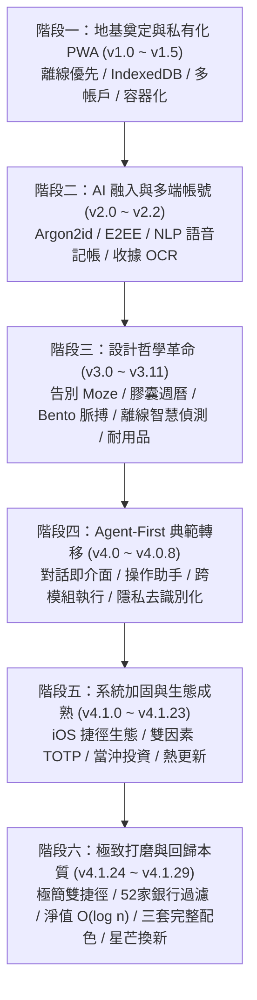

# Aster 記帳 — 未來 AI 協作全景交接指南（Agent.md）

> **致未來的 AI 協作夥伴：**
> 當你接手這個專案時，請先靜下心完整研讀本檔案。這不僅僅是一份軟體架構說明書，更是 Aster 從無到有、歷經數十個版本迭代所淬鍊出的**靈魂、心路歷程、美學堅持與工程憲章**。
>
> 專案版本基準：**v4.1.29**（2026-11-12）  
> 主力分支：`feature/v1.2`（完成後 fast-forward 合併至 `main`）  
> 當前測試規模：前端 **874** 項 ＋ 後端 **198** 項 ＝ **1,072** 項全數通過  
> 介面語言：**繁體中文（台灣習慣用語，zh-TW）**  

---

## 1. Aster 的由來與命名哲學

### 1.1 語源與星芒意象
**Aster** 之名源自古希臘文 **ἀστερίσκος**（*asteriskos*），其字面本義為「**小星星（Little Star）**」或古代文獻中的「**星號（＊）**」。

在古希臘古籍與校勘學中，學者會在手稿旁畫上一顆小星號，用以標註文字間最值得深思、不可遺漏或需要補充的微小細節。
在財務與日常生活中，每一筆微小的開銷、每一次菜市場的掏銅板、每一杯清晨的咖啡，正如浩瀚銀河中一顆顆看似不起眼的小星星。
**Aster 的核心信仰是：**
> 理財不是冷冰冰的會計報表，而是記錄生活節奏與人生軌跡的星圖。
> 隨手標記每一筆微光，聚沙成塔，這些小星芒終將匯聚成照亮個人財務自由與內心平靜的明亮夜空。

### 1.2 命名歷史演變與底層相容性遺留（The Clure Heritage）
專案最初在草創期（v1.0.0 ～ v1.3.0）原名為 **Clure**。
在 v1.3.1，開發者為了更深刻地表達「隨手點亮生活微光」的意象，正式將品牌與軟體名稱昇華為 **Aster**。

**【AI 必背鐵律：底層舊名相容性】**
雖然對外品牌、PWA 名稱、UI 介面全面更名為 Aster，但為了**絕對保證既有使用者在 NAS 上運行的資料庫卷（Docker volumes）、資料夾路徑、PostgreSQL 帳號、本機 IndexedDB（`clure`、`clure-u{userId}`）、`.env` 環境變數前綴（`CLURE_*`）、`x-clure-token` 請求標頭與 Cookie 不發生遷移中斷或資料損毀**：
- 後台底層、資料庫名稱、Docker 專案名與環境變數前綴**永久保留 `CLURE`**。
- 未來的 AI 絕不可擅自將這些底層標識「重構」為 Aster，否則將導致所有既有私有化部署者的歷史資料庫斷鏈！

### 1.3 品牌標記的蛻變（From Skeuomorphism to Pure Asterisk）
Aster 的視覺標記經歷了深刻的去蕪存菁：
1. **草創期**：曾採用星軌草寫「A」搭配立體球體與高光陰影。
2. **中期探索**：底部導覽列中央按鈕曾帶有立體漸層、微光穹頂與長按光暈。
3. **v4.1.29 重大回歸**：
   - 徹底屏棄繁複的立體漸層、光暈與高光，回歸平面、純粹、現代的極致美學。
   - 品牌標記全面換上 **Lucide `asterisk` 星芒圖標**（26px 圓頭直線幾何，遵循 ISC 授權），深空中性底（#1C1C1E）搭配純淨星芒。
   - 中央主按鈕改為 48px 平面霧面實色圓盤，與全 App 一致的 iOS 圓角與線條語言融為一體。

---

## 2. 歷屆版本演進全景圖（v1.0.0 ～ v4.1.29）

Aster 經歷了六個波瀾壯闊的發展階段：



### 階段一：地基奠定與私有化 PWA 誕生（v1.0.0 ～ v1.5.1，2026-10）
- **核心動機**：受夠了市售商業記帳 App 的高額訂閱制、氾濫廣告、個人資產數據上傳第三方伺服器的隱私風險。
- **技術選型**：借鑒 Moze 4.0 的人體工學，以 React 18 + TS strict + Vite 5 + Dexie 4 (IndexedDB) + FastAPI 打造離線優先（Offline-First）PWA。
- **里程碑**：
  - 奠定 Dexie 本機資料庫架構，離線可用，開啟 App 瞬間秒開。
  - 多幣別、雙層分類、標籤、計算機鍵盤（不用危險的 `eval`）。
  - Excel/CSV 匯入匯出、Docker NAS 容器化與反向代理整合。
  - v1.3.1 正式更名為 Aster。

### 階段二：AI 初試啼聲與多端帳號系統（v2.0.0 ～ v2.2.4，2026-10）
- **安全帳號系統**：引入 Argon2id 密碼雜湊、HttpOnly Cookie、雙向增量同步引擎（`sync_outbox` / `sync_records`）。
- **AI 萌芽**：
  - 自然語言（NLP）解析金額、日期、分類與多筆記帳。
  - 收據 OCR 拍照辨識，壓縮後儲存於本機。
  - 首頁初階 AI 問答與消費趨勢分析。

### 階段三：設計哲學革命——告別 Moze 框架，誕生專屬靈魂（v3.0.0 ～ v3.11.0，2026-10 ～ 11）
- **v3.0.0 重大轉折**：不再只是「開源版 Moze」，正式走出獨立設計語言：
  - 創造「**膠囊週曆**」與「**當日脈搏 Bento 儀表板**」，單日花費與歷史走勢一目了然。
  - 靈動島 Liquid Glass 交互體驗、手勢阻尼與 Q 彈彈簧動效（Spring Animations）。
- **特色功能爆發**：
  - **純本機離線智慧偵測**（v3.6.0）：以本機規則運算未登記訂閱、漲價、重複扣款、異常大額與分類暴增，**零延遲、不消耗伺服器與 AI 額度**。
  - **耐用品真實成本（Durable Goods）**（v3.9.0）：計算高單價物品（如手機、筆電）的「每日持有成本（Daily Holding Cost）」，重新定義消費觀。
  - **統一發票自動對獎器**（v3.7.0）：掃描電子發票 QR Code 秒對獎。
  - **資金流向桑基圖（Sankey）**（v3.8.0）：視覺化金流自各收入源流向各資產與開銷。
  - **多通道外部通知**（v3.10.0）：Discord、Telegram、LINE 與自訂 Webhook 即時推播。

### 階段四：Agent-First 典範轉移與對話即介面（v4.0.0 ～ v4.0.8，2026-11）
- **操作助手（Action Assistant）**：AI 不再只是「被動回答問題的聊天機器人」，而是「能執行真實世界金融指令的 Agent」：
  - 一句話跨帳戶操作：「把玉山的一萬轉到國泰，順便買 50 股台積電」。
  - **原子性與可逆性**：所有操作生成複合預覽卡，使用者確認後才整包落盤，並具備「一鍵復原（Undo）」機制。
- **雙軌分流架構**：
  - 簡單查帳／統計：本機規則引擎 0 毫秒直答。
  - 深度財務分析：送出前經過**去識別化（De-identification）**脫敏處理，保護用戶隱私。

### 階段五：系統加固、無縫整合與生態成熟（v4.1.0 ～ v4.1.23，2026-11）
- **iOS 捷徑生態全面深化**：
  - 錢包感應（Apple Pay）自動入帳、簡訊記帳、Siri 一句話記帳。
- **全方位資安加固**：
  - TOTP 雙因素驗證、已登入裝置管理、PIN 連續輸錯自動清除本機資料。
  - 容器以非 root 降權運行、Docker 映像熱更新（Hot Reload）機制。
- **專業投資組合**：
  - 台股（TWSE/TPEx）、美股即時行情代理（quote-proxy）。
  - 現股當沖支援、二代健保除息試算、資產歷史淨值推估。

### 階段六：極致打磨、回歸本質與全新配色體系（v4.1.24 ～ v4.1.29，2026-11）
- **自動記帳收斂為「極簡雙捷徑」**（v4.1.25）：
  - 刪除繁瑣多餘的 6 捷徑配置，收斂為：
    1. ⚡ **Aster 自動記帳**（通知與 Apple Pay 背景無感自動入帳，覆蓋台灣主流 52 家銀行與行動支付）。
    2. 🎙️ **Aster 隨手記**（Siri 語音聽寫 ＋ 系統分享選單文字記帳）。
  - 建立銀行行銷推播與雙11等非交易促銷雜訊過濾機制。
- **視覺減法與介面大整頓**（v4.1.27 ～ v4.1.28）：
  - 移除設定頁面十數處過度說明的 ⓘ 圖標，僅保留真正具有自動化或加密機制的關鍵項目。
  - 「智慧偵測與預警」重構為標準 iOS Glass 狀態卡片與圓角圖示開關。
  - **版本更新重點標題嚴格限制 $\le 10$ 字**，並由單元測試永久鎖死。
  - 月底資產淨值歷史回推演算法重構：帳戶分組排序 ＋ 前綴和二分搜尋，運算複雜度由 $O(M \cdot A \cdot N)$ 驟降為 $O(M \cdot A \log N)$。
- **三套完整調和配色與星芒標記換新**（v4.1.29）：
  - 推出「**石墨冰藍、霧白墨綠、暖灰琥珀**」三套完整調和配色，深淺色皆經過精準對比度調校。
  - **深色共用中性灰底架構**：徹底解決深色模式整頁被色彩罩住的霧茫茫毛病，深色底層維持乾淨中性黑灰，色相專注於 accent 點綴。
  - 中央主按鈕霧面平面化，換上標準 Lucide asterisk 星芒標記。

---

## 3. 心路歷程與設計哲學（The Soul of Aster）

未來的 AI 開發者，在修改任何程式碼或提出新設計前，請務必銘記以下五大核心哲學：

### 哲學一：資料所有權絕不妥協（Self-Hosted & Privacy First）
> **「你賺的每一分錢、花的每一筆開銷，是你最真實的生命印記。這份數據不屬於任何雲端巨頭，只屬於你自己。」**
- 系統必須隨時能夠完全離線運作。
- 所有送往外部 AI（如 Gemini、OpenAI）的文字，必須事先經過 `deidentify.ts` 脫敏（去除帳戶名、金額、商家具體名稱、敏感備註）。
- 本機端備份一律支援 AES-256-GCM 本機加密。

### 哲學二：離線優先，單一真相來源（Offline-First & Single Truth）
> **「網路是貨運司機，IndexedDB 才是倉庫。」**
- 使用者在收訊不良的地下街、捷運或海外飛機上掏出手機，記帳必須零延遲完成。
- **單一真相來源永遠是本機 IndexedDB（透過 Dexie liveQuery）**。UI 絕對不可自行維護第二份非同步資料快取。
- 所有跨日計算（如定時入帳、到價提醒、分期付款、匯率拉取），在 iOS PWA 無背景運行的限制下，一律在開啟 App 時由 `services/startup.ts` 補算補齊。

### 哲學三：極致的克制與減法美學（Ruthless Subtraction）
> **"Avoid unnecessary secondary labels and descriptions. Let the layout do the explaining."**
- **不要滿螢幕都是說明文字**：Aster 歷經多次使用者反饋「太雜亂、太醜、看不懂」。好的介面應當像 iOS 原生系統一樣，佈局本身就是最好的指引。
- **克制的功能入口**：如果能用 2 個捷徑解決，就絕不要做 6 個；如果一項設定顯而易懂，就絕不要加上 ⓘ 圓圈圖標。
- **版本更新重點標題不得超過 10 個字**：這是使用者的明確堅持。短小、精準、白話，不寫誇大不實的廢話。

### 哲學四：AI 是隱形管家，而非雜耍藝人（Agent as Invisible Steward）
> **「最好的 AI 是讓使用者感受不到 AI 的存在，卻時刻受到守護。」**
- 不要為了秀技術而強迫用戶看 AI 思考過程。
- AI 的主要舞台在於**本機端默默巡邏**：偵測異常漲價、抓出重複扣款、提醒被遺忘的訂閱服務。
- 當用戶主動喚出 AI（唯一上滑手勢）時，AI 要能直接看懂當前畫面內容（Screen Context），一句話完成複雜任務，並永遠附帶**操作預覽與撤銷（Undo）安全閥**。

### 哲學五：金融級的嚴謹精度（Financial Rigor）
> **「金錢運算裡，一分錢的浮點數誤差都是不可原諒的工程災難。」**
- **金額一律使用幣別最小單位的整數**（TWD 1 元在內部以整數儲存，若支援分則為整數分）。
- **嚴禁在金額加減乘除中直接使用 JavaScript IEEE 754 浮點數運算**。大數與除法必須使用 `decimal.js` 或封裝好的 `Money` 類別。
- 帳戶餘額與每筆交易變更必須封裝在同一個 Dexie 資料庫事務（Transaction）內，餘額快取若損壞必須能隨時從帳目流水無損重建。

---

## 4. 系統架構與技術藍圖

### 4.1 前端技術矩陣
| 維度 | 技術選型 | 關鍵規範 |
|---|---|---|
| **核心框架** | React 18 + TypeScript 5.9 (strict) + Vite 5 | `npm run build` 包含 strict 型別檢查與 production 打包 |
| **本機資料庫** | Dexie 4 + dexie-react-hooks | DBCore 中介層攔截所有變更寫入 `sync_outbox` |
| **狀態管理** | Zustand 4 | **僅存放 UI 臨時狀態與用戶設定**，不存業務資料實體 |
| **PWA / SW** | vite-plugin-pwa (injectManifest) + 自訂 `src/sw.ts` | 離線預快取、更新冷卻通知、Web Push 接收端 |
| **圖表系統** | Apache ECharts 5 (按需加載) | 資產趨勢圖、資產分佈環形圖、桑基金流圖 |
| **圖標體系** | Lucide Icons (ISC License) | 統一於 `src/ui/Icon.tsx` 與 `src/ui/CatIcon.tsx` |
| **手勢與動效** | 原生 Pointer Events + CSS Spring Transform | 支援手勢阻尼跟手、唯一靈動島上滑叫出 AI |

### 4.2 後端技術矩陣（`server/`）
| 維度 | 技術選型 | 關鍵規範 |
|---|---|---|
| **API 框架** | FastAPI (Python 3.12) + Uvicorn | 異步路由、Pydantic v2 資料校驗 |
| **ORM / 遷移** | SQLAlchemy 2.0 + Alembic | 啟動時自動套用遷移；支援 SQLite 與 PostgreSQL 16 |
| **認證與安全** | Argon2id + PyJWT + cryptography | HttpOnly Cookie 搭配 Refresh Token 輪替機制、TOTP 雙因素 |
| **推播系統** | pywebpush (VAPID / aes128gcm) | 加密例外容錯隔離，壞金鑰不中斷整批發送迴圈 |
| **架構分層** | 嚴格五層架構 | `api` (路由) $\rightarrow$ `service` (業務) $\rightarrow$ `repository` (DB) $\rightarrow$ `model` / `schema` |

### 4.3 報價代理核心（`proxy/`）
- **同一份核心邏輯**：`proxy/src/core.ts` 同時供 NAS Node.js 伺服器、Cloudflare Workers 與 Vite 開發代理共用。
- **嚴格白名單與防護**：僅允許白名單網域（TWSE、TPEx、Yahoo Finance、FinMind 等），每 IP 每分鐘 120 次頻率限制，記憶體多級快取（盤中 10 秒、名單 30 分鐘）。

### 4.4 核心目錄地圖
```
Aster/
├── assets/                  # 品牌來源向量圖（icon.svg - 深空中性底＋星芒）
├── docs/                    # 各模組深入設計文件（ICONS、SYNC、NOTIFY、INBOX、AI...）
├── public/                  # 靜態資源、PWA 圖標、iOS 啟動畫面、快捷捷徑檔 (.shortcut)
├── server/                  # FastAPI 後端（五層架構、Alembic 遷移檔、pytest 測試）
├── proxy/                   # 股價與即時匯率代理核心（Node / Cloudflare Worker / Vite）
├── scripts/                 # 維護腳本（pack-nas.sh、make-shortcuts.py 等）
├── src/
│   ├── app/                 # 全域外框：TabBar 導覽列、AuthGate 守門、LockScreen、Overlays
│   ├── db/                  # Dexie 本機資料庫 schema、DBCore 中介層、repo 存取層
│   ├── domain/              # 純邏輯領域層（無 UI、無 DB、100% 單元測試覆蓋）
│   ├── features/            # 各功能模組頁面與元件（home, ledger, accounts, ai, invest...）
│   ├── services/            # 系統服務（同步引擎、推播、捷徑處理、更新提示、匯率...）
│   ├── stores/              # Zustand 狀態庫（auth, settings, ui, sync）
│   ├── theme/               # 全域樣式與調和配色變數（app.css）
│   └── ui/                  # 通用設計原子元件（Button, Sheet, Switch, Icon, CatIcon...）
├── tests/unit/              # Vitest 前端單元測試集（874 項測試）
├── Agent.md                 # ★ 本文件：給未來 AI 的全景交接指南與工程憲章
├── CHANGELOG.md             # 官方逐版變更歷史紀錄
├── FEATURES_FOR_AI.md       # 詳細業務領域規則字典（發票、稅務、耐用品、投資演算法）
├── LICENSE-LUCIDE.md        # Lucide 圖標開源授權聲明（法規遵循保留）
├── README.md                # 開源專案 GitHub 首頁與 Docker 架設說明
└── SECURITY.md              # 安全策略、威脅模型與漏洞回報指南
```

---

## 5. 給未來 AI 的發布守則與開發鐵律

每當使用者要求你修改程式碼或發布新版本時，請將以下規範刻在你的執行邏輯中：

1. **版本號決定權**：
   - **版本號嚴格由使用者指定**。不要自行跳號、不要自行升版，除非使用者明確下達指令。
2. **版本更新重點（WhatsNew）標題限制**：
   - 在 `src/features/whatsnew/releaseNotes.ts` 新增或修改功能時，**每個功能的標題（`title`）嚴格限制不得超過 10 個字**！
   - 此規則由 `tests/unit/release-notes.test.ts` 自動化斷言保護，超過 10 字 CI 將直接報錯失敗。
3. **介面文字與語系**：
   - 所有面向使用者的文字，一律使用**繁體中文（zh-TW，台灣習慣用語）**，例如「帳戶」、「捷徑」、「儲存」、「預算」、「匯入」。
4. **發布前驗證三步曲**：
   - **第一步：前端全綠**：執行 `npm run check`（包含 TypeScript strict 檢查、ESLint 與 Vitest 前端測試）。
   - **第二步：後端全綠**：執行 `cd server && .venv/bin/python -m pytest -q`（後端測試全綠）。
   - **第三步：正式打包**：執行 `npm run build && npm run pack:nas` 產出最新 `aster-nas.zip`。
5. **Git 與 CI 紀律**：
   - 每次 commit 必須附帶 `Co-Authored-By` trailer。
   - 推送至 `origin/feature/v1.2` 後，必須快轉合併（`--ff-only`）至 `main` 並推送至 `origin/main`。
   - **測試未全綠前絕不允許推送程式碼；任何情況下絕不 force-push**。
   - 隨時關注 GitHub Actions CI 狀態，確認雙分支全數綠燈。
6. **資安鐵壁**：
   - 回覆內容、commit 訊息與任何文件**絕對不得輸出任何 `.env` 密鑰、Token、密碼或連線字串的真實值**。遇到安全疑慮只能指出風險與修復方案。

---

> **結語：**
> Aster 不僅僅是一行行簡潔優雅的 TypeScript 與 Python 程式碼，更是無數個夜晚對生活細節的溫柔審視。
> 請帶著對這份星芒的敬意與守護之心，繼續讓 Aster 在使用者的手中發光發熱。
