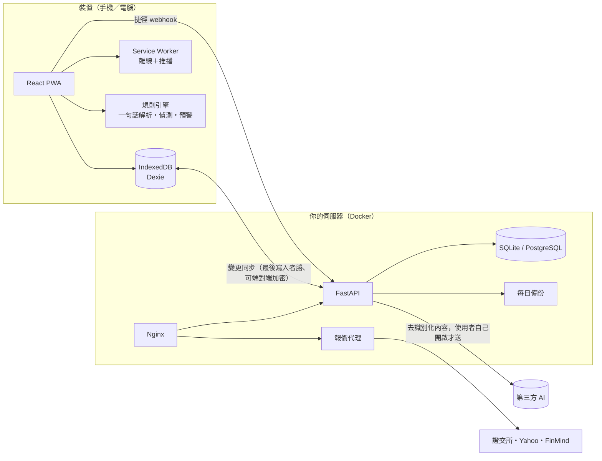
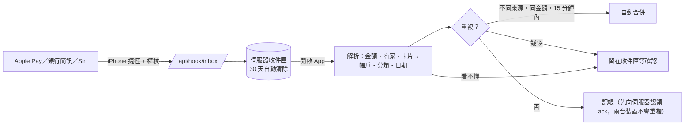

# 架構與核心功能設計說明

> 給想快速了解 Aster 怎麼運作的人（評審、新貢獻者）。細節在各檔案開頭的繁體中文註解與其他 docs。

## 1. 一張圖看全貌



**設計原則**
1. **離線優先**：所有操作先寫本機 IndexedDB，立刻可用；同步是背景工作，斷線不影響記帳。
2. **資料在自己手上**：自架伺服器、可選端對端加密、備份可加密。
3. **規則優先、AI 在後**：規則能做的（解析、偵測、預警）一律本機運算，不花額度、不外送；AI 只在使用者開啟、規則做不到時才用，並且去識別化、可檢查送出內容。
4. **純函式核心**：`src/domain/` 全是無副作用的純函式（金額、期間、解析、報表、偵測…），可獨立測試；`src/services/` 才碰資料庫與網路。

## 2. 資料與同步

- 金額一律以「最小單位整數」（minor units）存放並用 `decimal.js` 運算，避免浮點誤差；多幣別帳目同時保存原幣、帳戶幣別、主幣別金額。
- 每次寫入由 Dexie middleware（`db/sync-tracking.ts`）記入待上傳佇列（outbox）；同步引擎（`services/sync.ts`）上傳、下載、以修改時間「最後寫入者勝」合併；刪除用墓碑。
- 兩台裝置各自新增同一檔股票／同名標籤時，唯一索引會讓下載失敗——所以這些索引不要求唯一，同步後由 `db/dedupe.ts` 決定性合併（id 小者留下）。
- 啟用端對端加密後，每筆資料以 AES-256-GCM 加密再上傳，伺服器只看得到資料表名稱、id 與時間。

## 3. 自動記帳管線



另有：一句話／語音記帳（`domain/nlp*.ts`）、電子發票載具（`services/carrier.ts`）、週期與分期自動入帳（`db/repo/plan.ts`，補算且冪等）、銀行對帳單／CSV 匯入。

## 4. 智慧提醒（異常與訂閱偵測、預算預警）

- 純規則、全部本機：`domain/anomaly.ts`（訂閱／漲價／重複扣款／異常大額／分類暴增）、`domain/budgetwarn.ts`（預計超支）。
- 防誤報：資料不夠不判斷、金額與次數都要過門檻、分期與已登記的週期帳目不重複提醒、「午餐」這類籠統備註不判斷重複、固定扣款（房租）不算異常大額。
- 效能：只讀最近 14 個月（日期索引）、結果快取 10 分鐘、開啟 App 時排在瀏覽器閒置時間執行。
- 白話說明由模板產生，不使用 AI、不計入額度；「重新偵測」與「白話說明」5 分鐘最多 10 次（`domain/usagelimit.ts`，滑動窗）。

## 5. AI 與隱私

- 三個開關預設全關；規則解析不了才送一句話；收支統計為整數且去識別化（`domain/aisummary.ts`）。
- 每次真正送出的原文都記在本機「AI 送出紀錄」（`services/aiLog.ts`），設定頁可查看；快取命中不會送出。
- 伺服器端：供應商鏈備援、熔斷、日／週／月額度（管理員與一般使用者分開）、失敗不扣額度。

## 6. 安全

見 [SECURITY.md](../SECURITY.md)：Argon2id、HttpOnly Cookie＋Refresh 輪替與重用偵測、CSRF、登入鎖定、嚴格 CSP、SSRF 防護、端對端加密、加密備份、審計日誌。

## 7. 可靠性

- 前端：Service Worker 預快取、更新要使用者同意才切換；進場動畫卡住有保險；資料健康檢查（`services/health.ts`）。
- 後端：資料庫遷移（Alembic）啟動時自動套用；每日自動備份（驗證完整性、保留 N 份）；`/api/health/ready`；詳見 [OPERATIONS.md](OPERATIONS.md)。

## 8. 品質

- 測試：前端 vitest（金額、期間、解析、報表、偵測、同步、備份…）與後端 pytest（認證、同步、AI、備份…）；兩台裝置同步、端對端的自動記帳流程都有測試。
- 靜態檢查：TypeScript（嚴格模式）、ESLint；CI 在每次推送自動跑全部測試與建置（`.github/workflows/ci.yml`）。
- 本機一鍵檢查：`npm run check`（型態＋ESLint＋測試）。

## 9. 目錄地圖

```
src/domain/     純函式（nlp*、anomaly、budgetwarn、reports、search、spring、usagelimit…）
src/db/         Dexie 結構、同步追蹤、資料表存取（repo/）
src/services/   同步、備份、AI、收件匣、推播、偵測執行層…
src/features/   各頁面（home、ledger、plan、reports、settings、insights、admin…）
server/app/     FastAPI：api/（路由）、service/（業務）、model/、core/
docs/           設計與維運文件
```
